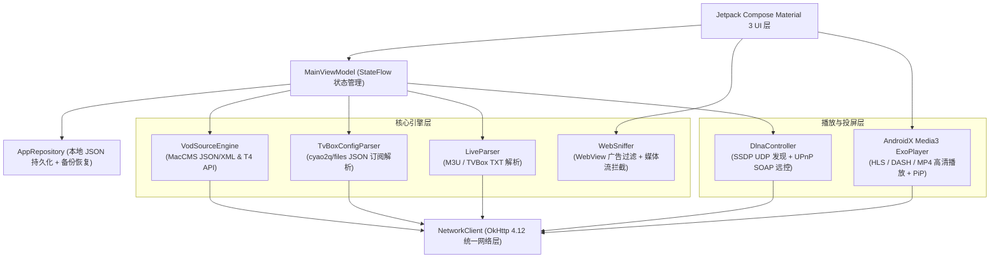

# 极光视界（CineCast）产品需求与系统架构设计文档

> **版本**：v1.0.0  
> **应用名称**：极光视界（CineCast）  
> **包名**：`com.cinecast.app`  
> **目标平台**：Android 7.0+（API 24 ~ API 35）  
> **设计风格**：Google Material Design 3（Material You 动态取色 + Google Blue 色彩系统）  
> **参考配置标准**：兼容 [cyao2q/files](https://github.com/cyao2q/files) 等 TVBox JSON 配置生态

---

## 1. 产品定位与核心功能矩阵

极光视界（CineCast）是一款遵循 **Google Material Design 3** 设计语言打造的现代化多源高清影视与投屏手机客户端。用户可自由接入各类视频源网站与订阅配置，享受无广告干扰的高清原生播放和一键电视大屏投屏体验。

| 功能模块 | 核心能力 | 技术实现 |
| :--- | :--- | :--- |
| **多协议视频源接入** | 支持苹果 CMS JSON（Type 1）、XML（Type 0）、TVBox T4 远程接口（Type 4）、**任意视频网站网页嗅探** | `VodSourceEngine` + `WebSnifferScreen` |
| **TVBox 生态配置兼容** | 一键订阅导入 `cyao2q/files/m.json`、`xs.json` 或任意 TVBox JSON 配置，自动解析 `sites` / `lives` / `parses` / `ads` | `TvBoxConfigParser`（支持去注释、相对路径解析） |
| **高清硬解播放器** | 支持 HLS (`.m3u8`)、DASH (`.mpd`)、MP4/MKV；支持 4K/1080P 分辨率角标、0.5x~3.0x 倍速、手势亮度/音量/进度调节、画面比例、画中画（PiP）、断点续播与自动连播 | AndroidX Media3 (`ExoPlayer` + `OkHttpDataSource`) |
| **局域网 DLNA 投屏** | 纯原生 SSDP 局域网发现 + UPnP AVTransport/RenderingControl 控制（播放/暂停/进度拖拽/音量/切集），兼容小米、华为、海信、TCL、创维、乐播投屏等设备；附带系统 Miracast 与外部播放器兜底 | `DlnaController`（无第三方 Cling 冲突） |
| **高清电视直播** | 支持标准 M3U/M3U8 与 TVBox TXT（`分组,#genre#`）格式，自动聚合多条备用线路，支持直接播放与一键投屏 | `LiveParser` + `LiveScreen` |
| **网页视频智能嗅探** | 内置支持广告屏蔽（`ads` 列表）的 WebView 浏览器，实时拦截 `.m3u8`/`.mp4`/`.flv` 流地址，并可一键调用 `parses` VIP 解析线路 | `WebSnifferScreen` |
| **谷歌风格 UI** | Jetpack Compose + Material 3，支持 Android 12+ Material You 壁纸动态取色、深色/浅色/跟随系统主题、沉浸式全面屏 | `CineCastTheme` |

---

## 2. 系统总体架构

---

## 3. 核心协议与关键技术说明

### 3.1 视频源协议兼容策略（参考 `cyao2q/files`）
经分析 `https://github.com/cyao2q/files` 仓库中的 `m.json` 与 `xs.json`，TVBox 生态配置包含以下核心字段：
1. **`sites`（站点列表）**：
   - `type: 0`：苹果 CMS XML 采集接口（例如 `非凡影视`、`量子资源` 的 `/api.php/provide/vod/at/xml/`）。本应用原生通过 `XmlPullParser` 解析分类、列表、搜索与多线路选集。
   - `type: 1`：苹果 CMS JSON 采集接口（`/api.php/provide/vod/`）。支持 `?ac=list`、`?ac=detail&t=...&pg=...`、`?ac=detail&wd=...`、`?ac=detail&ids=...`，响应最快、元数据最全。
   - `type: 4`：TVBox T4 远程服务端 JSON 接口，直接通过 HTTP 请求获取标准化片库。
   - `type: 3`：TVBox 自定义 JAR/JS 爬虫站点（依赖外部 `Bee.jar` 运行时）。导入时应用会自动识别并标注为「Spider 爬虫源」以供查看，避免误触发异常，同时引导用户使用直连高清源或内置「网页嗅探模式」直接访问目标影视网站。
2. **`lives`（直播源列表）**：
   - 自动解析 `interface.txt`（TVBox TXT 格式）和 `iptv.m3u`（标准 M3U 格式），同名频道自动合并备用线路。
3. **`parses`（VIP 网页解析接口）**：
   - 自动提取 `xmflv`、`pouyun`、`xymp4`、`yparse`、`8090g` 等解析接口，用户在内置「网页嗅探浏览器」浏览主流视频网站时，点击顶部魔法棒即可一键套用解析线路并嗅探真实 `.m3u8` 高清流。
4. **`ads`（广告域名过滤列表）**：
   - 自动同步至应用 `adBlockHosts`，在网页嗅探浏览时拦截广告与统计追踪请求。

### 3.2 高清播放架构（Media3 ExoPlayer）
- 采用 `OkHttpDataSource.Factory` 接管媒体流请求，具备自动重定向、高容错 TLS、自定义 `User-Agent` 能力。
- 支持智能线路排序：解析影片多线路（`vod_play_from` / `vod_play_url`）时，自动将 `.m3u8` 高清直链线路优先排序。
- 支持 **画面比例切换**（原始比例适应 / 裁剪铺满 / 拉伸全屏）、**倍速播放**（0.5x ~ 3.0x）、**手势交互**（左滑亮度、右滑音量、横滑快进退、双击暂停）、**Android 8.0+ 画中画（PiP）**。

### 3.3 DLNA / UPnP 局域网投屏架构
采用纯 Kotlin 实现，零第三方重型 UPnP 库依赖：
1. **SSDP 设备发现**：申请 `WifiManager.MulticastLock`，向组播地址 `239.255.255.250:1900` 发送 `M-SEARCH` 报文检索 `MediaRenderer:1` 与 `AVTransport:1` 设备。
2. **设备能力解析**：请求响应头中的 `LOCATION` 描述 XML，提取设备名称 `friendlyName`、`AVTransport` 与 `RenderingControl` 控制端点。
3. **SOAP 投屏控制**：构造标准 `DIDL-Lite` 元数据 XML，依次发送 `Stop` -> `SetAVTransportURI` -> `Play`，并开启 2 秒周期的状态轮询（`GetPositionInfo` / `GetTransportInfo`），在手机端实时同步电视播放进度条并支持远程拖拽进度与音量调节。

---

## 4. 视觉设计规范（Google Material Design 3）

- **色彩系统**：
  - Android 12+ 默认开启 **Material You 动态取色**（`dynamicLightColorScheme` / `dynamicDarkColorScheme`），与手机系统壁纸融为一体。
  - Android 11 及以下或关闭动态取色时，使用标准 **Google Blue（`#1A73E8` / 深色 `#8AB4F8`）** 与 Material 3 Surface Container 阶梯灰（`#F8F9FA` -> `#F1F3F4` -> `#E8EAED`）。
- **组件语言**：
  - 顶部采用 Google 标志性圆角悬浮搜索胶囊（`RoundedCornerShape(28.dp)`）。
  - 分类筛选采用 `FilterChip`，底部导航采用 Material 3 `NavigationBar` 选中胶囊高亮。
  - 海报卡片采用 2:3 比例、`14.dp` 圆角及底部渐隐遮罩，确保角标文字清晰可读。
