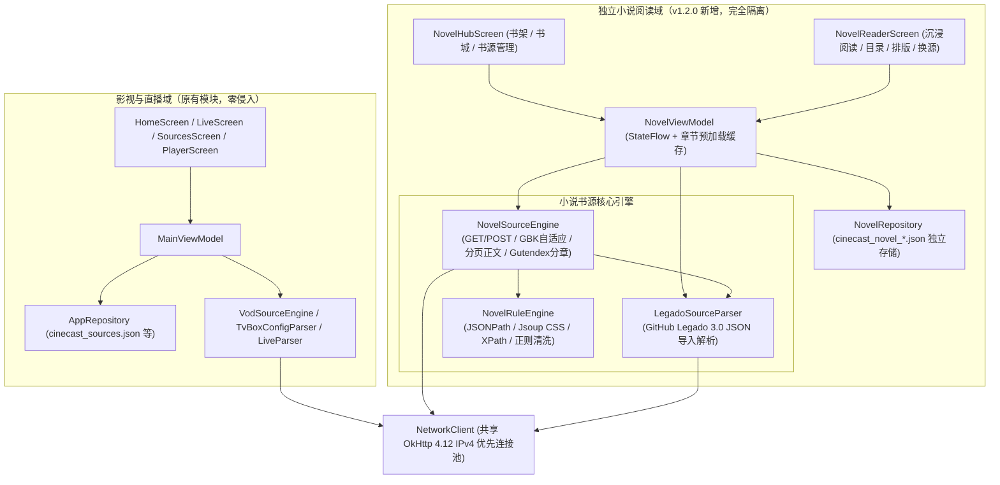
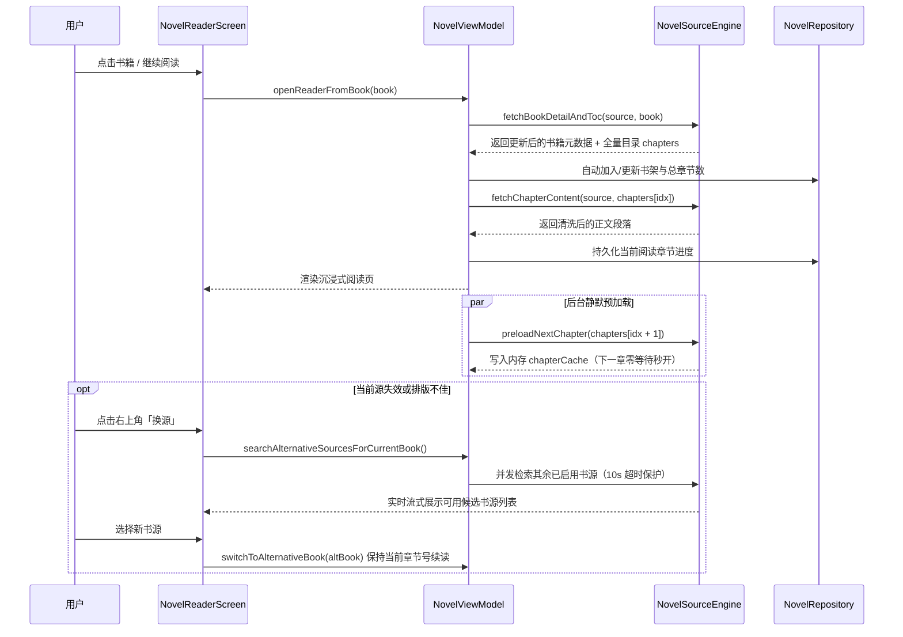

# 极光视界（CineCast）小说阅读模块详细设计文档

> **版本**：v1.2.0  
> **所属工程**：极光视界（CineCast）Android & iOS 双端客户端  
> **设计风格**：Google Material Design 3 / Google Play Books 纸感阅读语言  
> **书源协议标准**：兼容开源阅读 **Legado 3.0 Book Source JSON** 生态（`XIU2/Yuedu`、`liufuyou/read`、`openrepos/booksource` 等 GitHub 仓库）及 **Gutendex 开源公版名著 API**  
> **架构原则**：**源配置、数据存储、业务状态、交互入口与视频/直播模块 100% 物理隔离**

---

## 1. 模块定位与隔离设计原则

为确保新增的「小说阅读」模块不会与原有的「影视点播 / 电视直播 / TVBox 视频源」产生任何数据污染或交互混乱，本模块严格遵循 **四层完全解耦隔离** 设计：

| 隔离维度 | 视频 / 直播模块（既有） | 小说阅读模块（v1.2.0 新增） |
| :--- | :--- | :--- |
| **代码包路径** | `com.cinecast.app.data.*` / `ui.*` (iOS: `Models/`, `Services/`, `Views/`) | `com.cinecast.app.novel.*` (iOS: `Novel/`) |
| **源协议与模型** | `VideoSource` / `SubscriptionConfig`（MacCMS / TVBox） | `NovelSource` / `NovelSubscription`（Legado 3.0 JSON / Gutendex） |
| **本地持久化文件** | `cinecast_sources.json`、`cinecast_history.json`、`cinecast_favorites.json` | `cinecast_novel_sources.json`、`cinecast_novel_subscriptions.json`、`cinecast_novel_bookshelf.json`、`cinecast_novel_reading_settings.json` |
| **状态管理容器** | `MainViewModel` (iOS: `AppStore`) | `NovelViewModel` (iOS: `NovelStore`) |
| **主界面入口** | 底部导航「发现」「直播」「影视源」 | 独立底部导航「阅读」（内含分段式「书架 \| 书城 \| 书源」） |
| **配置备份恢复** | `BackupBundle`（视频源与播放器配置） | `NovelBackupBundle`（小说书源、书架与排版设置独立备份互通） |

---

## 2. 系统总体架构

---

## 3. 核心引擎与 Legado 书源协议设计

### 3.1 GitHub 开源书源导入解析（`LegadoSourceParser`）

应用原生兼容 GitHub 社区维护的 **Legado（阅读 3.0）书源 JSON** 格式（支持数组 `[...]` 或单条对象 `{...}`），并执行以下清洗与适配流程：

1. **类型筛选**：仅保留 `bookSourceType == 0`（文本小说源），自动跳过音频（`1`）和图片漫画（`2`）源。
2. **动态脚本容错**：
   - 若书源的 `searchUrl` 与 `exploreUrl` 均为纯 `@js:` / `<js>` 动态脚本，或正文规则为纯 JS 加密脚本，则自动跳过并统计 `skippedJsOnlyCount` 提示用户，避免导入无法执行的坏源。
   - 若某字段（如 `kind` 分类标签或 `coverUrl` 封面）仅在规则末尾附带 `@js:` 后处理脚本，解析器自动剥离末尾 `@js:` 保留前置声明式选择器，最大化兼容 GitHub 社区书源。
3. **协议自动识别**：
   - 自动检测 `ruleSearch.bookList` / `ruleToc.chapterList` / `ruleContent.content` 是否以 `$`（JSONPath）开头，自动归类为 `LEGADO_JSON`（JSON API 书源）或 `LEGADO_HTML`（HTML 规则书源）。
4. **发现分类解析（`exploreUrl`）**：
   - 同时兼容 Legado 传统文本行格式（`玄幻小说::/fenlei/1/{{page}}/`）与新版 JSON 数组格式（`[{"title":"热门","url":"..."}]`）。
5. **编码自动探测**：
   - 从 `searchUrl` 选项（如 `{"charset":"gbk"}`）与 HTTP 响应头 `Content-Type`、HTML `<meta charset=...>` 三级自动识别 `UTF-8` / `GBK` / `GB2312` / `GB18030`，彻底解决老牌中文小说站乱码问题。

### 3.2 通用规则求值引擎（`NovelRuleEngine`）

Android 端基于 **Jsoup 1.18.3** + **org.json** 实现轻量化 Legado 规则求值引擎，覆盖社区 90% 以上非 JS 书源语法：

| 语法类型 | 支持示例 | 求值语义 |
| :--- | :--- | :--- |
| **JSONPath 与模板** | `$.data`、`$[*]`、`/novels/api/book/{{$.book_id}}` | 支持多级点号寻址、数组索引及 `{{...}}` 动态插值 |
| **Legado 链式选择器** | `class.item.0@tag.h3.0@tag.a.0@text`、`id.list.0@tag.a` | 支持 `class.`、`id.`、`tag.`、`text.`、负索引（`-1`）、排除索引（`!0`）与切片/倒序（`[-1:0]`） |
| **标准 CSS 选择器** | `.bk`、`#chapterList a`、`@css:#pages .gr` | 原生透传至 Jsoup CSS 引擎 |
| **常用 XPath 转换** | `//meta[@property='og:novel:author']/@content`、`//div[@id="list"]/dl/dt[last()]/following-sibling::dd/a` | 自动映射为等效 Jsoup DOM 遍历，兼容绝大部分笔趣阁/杰奇模板 |
| **逻辑组合运算符** | `class.bookbox\|\|class.item`、`span.0@text&&span.1@text` | `\|\|` 回退择优，`&&` 多字段拼接 |
| **正则清洗替换** | `h3@text##\(\S+`、`class.con.0@html##\(本章完\)$` | 支持 `##pattern` 删除与 `##pattern##replacement` 替换 |
| **条件分页 URL** | `/tongren/<,index_{{page}}.html>` | 第 1 页取逗号前分支，第 2 页起取逗号后分支 |

### 3.3 实测预置的 GitHub 开源书源与订阅源

本版本直接从 GitHub 活跃开源书源仓库检索、分析并实测筛选出 **8 个高可用预置小说源** 与 **4 条一键订阅仓库**：

| 序号 | 预置书源名称 | 协议类型 | 来源仓库 / 生态 | 特点说明 |
| :---: | :--- | :---: | :--- | :--- |
| 1 | **酷我小说 (API)** | `LEGADO_JSON` | `XIU2/Yuedu` | 纯 JSON 接口直连，实测全链路秒开，无广告无验证码 |
| 2 | **古登堡开源名著** | `GUTENDEX_API` | Project Gutenberg | 永久直连，含 444 部中文古典名著与 7 万部世界文学，支持智能分章 |
| 3 | **速读谷** | `LEGADO_HTML` | `XIU2/Yuedu` | 分类齐全（玄幻/仙侠/都市/历史/科幻/言情），支持分页正文 |
| 4 | **全本同人** | `LEGADO_HTML` | `liufuyou/read` | GB2312 完本与同人精品，响应快速 |
| 5 | **ESJZone 轻小说** | `LEGADO_HTML` | `liufuyou/read` | 日系与翻译轻小说聚合源 |
| 6 | **手机小说** | `LEGADO_HTML` | `XIU2/Yuedu` | GBK 综合网文站，支持 XPath 目录解析 |
| 7 | **爱尚小说** | `LEGADO_HTML` | `liufuyou/read` | 经典网文全本源 |
| 8 | **英文原版小说** | `LEGADO_HTML` | `liufuyou/read` | 英文原著分级阅读源 |

**预置 GitHub 书源订阅链接（内置 jsDelivr CDN 加速）**：
- `https://fastly.jsdelivr.net/gh/XIU2/Yuedu@master/shuyuan`（`github.com/XIU2/Yuedu`）
- `https://fastly.jsdelivr.net/gh/liufuyou/read@main/sources/yiove-novel.json`（`github.com/liufuyou/read`）
- `https://fastly.jsdelivr.net/gh/liufuyou/read@main/sources/yck-novel.json`（`github.com/liufuyou/read`）
- `https://fastly.jsdelivr.net/gh/openrepos/booksource@main/yuedu.json`（`github.com/openrepos/booksource`）

---

## 4. 核心业务流程设计

### 4.1 沉浸阅读与在线换源流程

---

## 5. Google 风格 UI 与视觉规范（Material Design 3 / Google Play Books）

1. **统一 Google Material Design 3 顶栏与分段导航**：
   - 「阅读」页签顶部采用 `SingleChoiceSegmentedButtonRow` 三段式切换（**书架 \| 书城 \| 书源**），右上角集成 Google 标志性圆形搜索按钮，点击后展开 `28.dp` 大圆角搜索胶囊，支持「全书源聚合搜索 / 仅当前书源」快速切换。
2. **Google Play Books 风格书架**：
   - 顶部展示 `24.dp` 大圆角 **「继续阅读」焦点卡**（封面、当前章节名、线性阅读进度条、百分比与书源标签），一键断点续读。
   - 下方采用 3 列 `0.70` 书籍黄金比例网格，内置 5 套 Google 色系渐变默认封面（当书源无封面图时依然保持高级出版物美感）。
3. **沉浸式纸感阅读器（4 套 Google 护眼色板）**：

| 主题名称 | 背景色（Hex） | 正文色（Hex） | 辅助色（Hex） | 适用场景 |
| :--- | :---: | :---: | :---: | :--- |
| **纯净纸白（PAPER）** | `#FCFCFA` | `#1F1F1F` | `#5F6368` | 日间清晰印刷质感 |
| **暖黄羊皮（SEPIA）** | `#F6EFE0` | `#3E2F1C` | `#7A6855` | 长时间沉浸柔和护眼 |
| **护眼豆沙（SAGE）** | `#E5F0E3` | `#1F3322` | `#526A56` | 弱光/室内抗蓝光 |
| **深邃暗夜（NIGHT）** | `#121316` | `#DADCE0` | `#9AA0A6` | 夜间低眩光 AMOLED 省电 |

4. **阅读排版自定义**：
   - 支持 **字号（14sp ~ 28sp）**、**行距（1.40x ~ 2.20x）**、**字体风格（印刷衬线 Serif / 现代无衬线 Sans-Serif）**、**目录正/倒序快速跳转**、**底部进度滑块拖拽切章** 及 **一键日夜切换**。

---

## 6. 数据模型与持久化文件规范

所有小说模块数据存储于应用私有目录 `context.filesDir`（iOS 为 `Documents/`）的独立文件中：

- `cinecast_novel_sources.json`：`List<NovelSource>`（含书源规则、启用状态、测速延迟）
- `cinecast_novel_subscriptions.json`：`List<NovelSubscription>`（GitHub 书源订阅记录）
- `cinecast_novel_bookshelf.json`：`List<BookshelfItem>`（书架列表、当前章节索引、总章节数、最近阅读时间戳）
- `cinecast_novel_reading_settings.json`：`NovelReadingSettings`（主题、字号、行距、边距、字体）

独立导出备份 JSON（`NovelBackupBundle`）支持 Android 与 iOS 剪贴板一键互导，且与视频备份互不覆盖。

---

## 7. v1.4.0 高可用名著典藏架构升级

针对部分传统 HTML 规则站因改版或反爬导致「点开章节看不了」的问题，v1.4.0 对小说源引擎与默认书源进行了体系化重构：

1. **新增中文维基文库适配器（`WIKISOURCE_API`）**：
   - 基于 MediaWiki 官方开放 API（`zh.wikisource.org/w/api.php`），内置五大精选馆（四大名著与演义 / 古典小说名著 / 鲁迅与现当代经典 / 史学典籍与兵法 / 国学哲学与诗词）共 40+ 部全本经典，同时支持实时检索全库。
   - 正文抓取携带 `variant=zh-cn` 参数由服务端自动转为简体中文，并通过 `parseWikisourceHtml()` 彻底过滤导航表格、编辑标记与角标，保证 100% 纯净可读。
2. **扩充古登堡世界名著库（`GUTENDEX_API`）与酷我历史文学馆（`LEGADO_JSON`）**：
   - 古登堡升级为 7 大公版名著分类；酷我新增历史/演义/武侠/推理专题 API 源。
3. **默认高可用策略与存量升级迁移**：
   - `NovelRepository.loadAllSync()` 在老版本升级时自动注入新名著源、移除 HTTP 502 失效源，并将易受反爬影响的传统 HTML 规则源默认设为关闭（用户仍可在「书源」页按需开启或导入任意 GitHub Legado 书源）。

---

## 8. v1.5.0 评书音频源与「听评书」子系统

1. **双通道免费评书音频源接入**：
   - **喜马拉雅评书馆（`XIMALAYA_PINGSHU`）**：通过公开评书分类接口（自动过滤付费专辑）与移动端分集接口拉取单田芳《白眉大侠》（401回）、《乱世枭雄》（485回）、郭德纲单口评书及 3000+ 免费评书，通过 `m.ximalaya.com/tracks/{id}.json` 解析腾讯云 COS M4A 音频直链。
   - **酷我评书名家馆（`KUWO_PINGSHU`）**：通过专辑接口与全库曲目搜索接入单田芳《隋唐演义》（142回）、连丽如《雍正剑侠图》（378回）、刘兰芳《大唐侠女》（62回）、袁阔成《三国演义》、郭德纲《济公传》等名家作品，经 `antiserver.kuwo.cn` 秒解 MP3 音频直链。
2. **专属听评书语音内核（`PingshuAudioController`）与播放器（`PingshuPlayerScreen`）**：
   - 采用独立 Media3 ExoPlayer（`C.AUDIO_CONTENT_TYPE_SPEECH` + `C.WAKE_MODE_NETWORK` 唤醒锁），与视频及音乐播放器自动互斥防串音。
   - 支持 **0.75x ~ 2.0x 倍速**、**快退 15 秒 / 快进 30 秒**、**助眠定时关闭（15/30/60 分钟 / 播完本回）**、**正倒序选回目录**、**自动连播下一回**及独立持久化文件 `cinecast_pingshu_history.json` **断点续听**。
