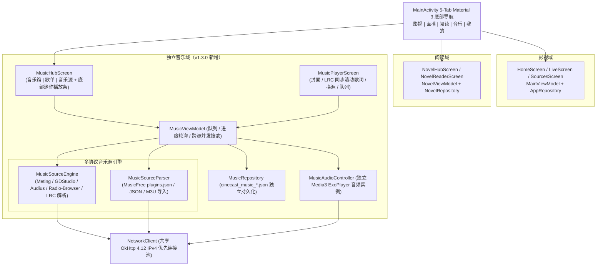

# 极光视界（CineCast）音乐模块详细设计文档

> **版本**：v1.3.0  
> **所属工程**：极光视界（CineCast）Android & iOS 双端客户端  
> **设计风格**：Google Material Design 3 / YouTube Music 现代音乐交互语言  
> **音乐源生态**：兼容 **Meting API**（`injahow/meting-api`、`metowolf/Meting`）、**GDStudio 聚合音乐 API**、**Audius 开源曲库**、**Radio-Browser 全球在线电台**、**MusicFree `plugins.json` 订阅** 及 **标准 M3U 音频歌单**  
> **隔离架构原则**：**音乐源、歌单收藏、音频播放内核、ViewModel 与影视模块、小说阅读模块 100% 物理与逻辑隔离**

---

## 1. 三域完全隔离架构设计

极光视界 v1.3.0 正式演进为 **「影视 · 阅读 · 音乐」三栖个人媒体中心**，三大业务域严守独立边界：

| 隔离维度 | 影视 / 直播域（v1.0+） | 小说阅读域（v1.2.0） | 音乐播放域（v1.3.0 新增） |
| :--- | :--- | :--- | :--- |
| **代码包路径** | `com.cinecast.app.data.*` / `ui.*` | `com.cinecast.app.novel.*` | `com.cinecast.app.music.*` (iOS: `Music/`) |
| **源协议标准** | MacCMS JSON/XML / TVBox / IPTV M3U | Legado 3.0 书源 JSON / Gutendex | Meting / GDStudio / Audius / Radio-Browser / MusicFree / M3U |
| **持久化文件** | `cinecast_sources.json` 等 | `cinecast_novel_*.json` | `cinecast_music_sources.json`、`cinecast_music_subscriptions.json`、`cinecast_music_favorites.json`、`cinecast_music_playlists.json`、`cinecast_music_recent.json`、`cinecast_music_settings.json` |
| **状态容器** | `MainViewModel` (`AppStore`) | `NovelViewModel` (`NovelStore`) | `MusicViewModel` (`MusicStore`) |
| **媒体播放内核** | `PlayerScreen` 视频 ExoPlayer / AVPlayer | 纸感 Compose/SwiftUI 文本渲染器 | `MusicAudioController` 独立音频 ExoPlayer / AVPlayer（播放视频时自动暂停音乐防串音） |
| **独立备份格式** | `BackupBundle` | `NovelBackupBundle` | `MusicBackupBundle` |

---

## 2. 系统总体架构图

---

## 3. 多协议开源音乐源引擎设计

### 3.1 预置实测可用音乐源（全链路直连验证）

本版本实测验证了音频流（HTTP 200 `audio/mpeg`）、封面图与 LRC 逐行同步歌词，精选内置 **5 个高可用开源音乐源**：

| 序号 | 预置音乐源 | 协议类型 | 开源出处 | 核心能力 |
| :---: | :--- | :---: | :--- | :--- |
| 1 | **云音乐榜单 (Meting-Injahow)** | `METING_API` | `injahow/meting-api` | 热歌榜 / 飙升榜 / 新歌榜 / 原创榜 / 欧美热歌，音频流与 LRC 歌词直连 |
| 2 | **GD音乐台 · 曲库搜歌** | `GDSTUDIO_API` | `music-api.gdstudio.xyz` | 320kbps 高音质全库搜歌 + 动态解析播放直链、500px 封面与同步歌词 |
| 3 | **云音乐镜像 (metowolf-Meting)** | `METING_API` | `metowolf/Meting` | 独立开源镜像，自动容灾备用 |
| 4 | **Audius 全球独立音乐** | `AUDIUS_API` | Audius Open API | 欧美/电子/Lo-Fi/流行全曲免费无损直连，支持全库搜索 |
| 5 | **Radio-Browser 在线音乐电台** | `RADIO_BROWSER` | `radio-browser.info` | 全球 30,000+ 24h 实时广播电台（含华语音乐台、爵士、古典、Lo-Fi） |

### 3.2 GitHub 开源订阅导入引擎（`MusicSourceParser`）

在 **「音乐 → 音乐源」** 中支持一键拉取或粘贴导入以下开源格式：
1. **MusicFree 社区 `plugins.json` 订阅**（如 `Huibq/keep-alive`、`maotoumao/MusicFreePlugins`）：自动解析插件列表并将识别到的主流音源（网易/小芸/小秋/电台/独立音乐）映射至原生高性能音频引擎，无需 Node.js 运行时即可直接播放。
2. **CineCast 通用开源音乐源 JSON 数组**：支持自定义 Meting / GDStudio / Audius / Radio-Browser 端点及榜单配置。
3. **开源 M3U / M3U8 音乐电台歌单**：解析 `#EXTINF` 标题、分组与台标，直接作为可播音乐源接入。

### 3.3 LRC 同步歌词解析与音频焦点管理

- **LRC 解析器（`MusicSourceEngine.parseLrc`）**：支持标准 `[mm:ss.xx]` / `[mm:ss.xxx]` 与单行多时间戳（如 `[00:15.80][01:20.50]`），自动排序并在全屏播放器中根据 `playbackState.positionMs` 实时高亮居中滚动；支持点击任意歌词行跳转播放进度。
- **音频防冲突与焦点控制**：`MusicAudioController` 配置 `C.USAGE_MEDIA` + `C.AUDIO_CONTENT_TYPE_MUSIC` 与 `setHandleAudioBecomingNoisy(true)`（拔出耳机自动暂停）；当用户在影视/直播页打开视频播放时，宿主自动调用 `musicViewModel.pauseAudio()` 避免双轨串音。

---

## 4. Google / YouTube Music 视觉与交互规范

1. **顶部栏与四段式无边框胶囊导航**：`极光音乐` 标识 + 活跃音乐源下拉胶囊 + 圆形搜索按钮；下方采用柔和无边框胶囊切换（**音乐馆 \| 歌手 \| 歌单 \| 音乐源**），首屏更通透。
2. **歌手分类精准查询（v1.3.1 新增）**：内置 7 大分类（全部热门 / 华语男歌手 / 华语女歌手 / 华语组合乐队 / 欧美流行 / 日韩歌手 / 轻音乐纯音）共 40 位精选歌手与自定义歌手名直查框，点击任意歌手后跨 GDStudio / Meting / Audius 并发聚合该歌手作品列表，并按歌手匹配度智能置顶排序。
3. **焦点推荐与迷你播放条**：音乐馆顶部新增「今日焦点 · TOP 1」渐变推荐卡与「热门歌手直达」圆形头像条；底部采用悬浮圆角 `20.dp` 迷你播放胶囊条。
4. **响应式全屏音乐播放器（`MusicPlayerScreen`）**：
   - 竖屏采用沉浸式大封面 + 同步歌词布局，横屏（如桌面支架场景）自动切换为左侧封面/歌词 + 右侧控制面板的双栏 YouTube Music 布局。
   - 顶部提供 **「歌曲封面 \| 同步歌词」** 分段切换与右上角 **「换源」** 按钮（并发检索其余已启用音源中的同名歌曲无缝切换）。
   - 底部提供交互式进度滑块、三种循环模式（列表循环 / 单曲循环 / 随机播放）、圆形播放主按钮、红心收藏、加入自定义歌单及 **播放队列抽屉**。

---

## 6. v1.4.0 自动连播增强与同曲跨源容灾架构

1. **高可靠自动连播下一首（Android + iOS 双端修复）**：
   - **Android (`MusicAudioController`)**：ExoPlayer 启用 `.setWakeMode(C.WAKE_MODE_NETWORK)`（配合 `WAKE_LOCK` 权限）确保锁屏/后台不断网、不断播；引入 `hasSignaledEndedForCurrentItem` 防重入状态机，并在 400ms 轮询器中增加 `Player.STATE_ENDED` 兜底检测，避免播完事件被丢弃。
   - **iOS (`MusicStore`)**：为每个 `AVPlayerItem` 绑定 `.AVPlayerItemDidPlayToEndTime`、`.AVPlayerItemFailedToPlayToEndTime` 与 KVO `status == .failed` 监听，实现播完自动连播与异常自动触发容灾。
2. **同曲跨音源自动容灾切换（`autoSwitchSameSongOrAdvance`）**：
   - 无论是在播放当前曲目、点击下一首还是自动连播下一首时，只要遇到**音频直链解析为空、解析超时或 ExoPlayer/AVPlayer 播放报错**，系统立即按国内高速优先顺位（`VKEYS_API -> KUWO_DIRECT -> GDSTUDIO_API -> METING_API -> AUDIUS_API`）跨其余未尝试过的已启用音源检索**同一首歌曲**。
   - 通过 `MusicSourceEngine.pickBestSameSongCandidate()` 对归一化歌名、歌手进行打分，并自动惩罚无关伴奏/DJ/翻唱版本，命中后立即解析直链、原地更新队列项并无缝起播（Toast 提示已切换音源）。
   - 若所有已启用音源均不可播，才自动跳过至队列下一首，并通过 `consecutiveAutoSkipCount` 上限保护（最多连跳 5 首）防止断网环境下无限循环。
